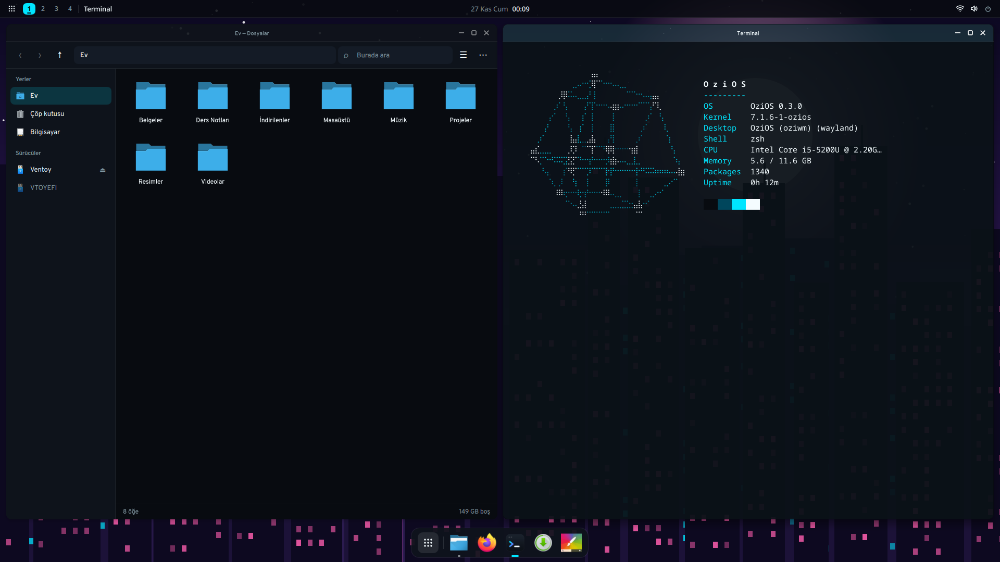
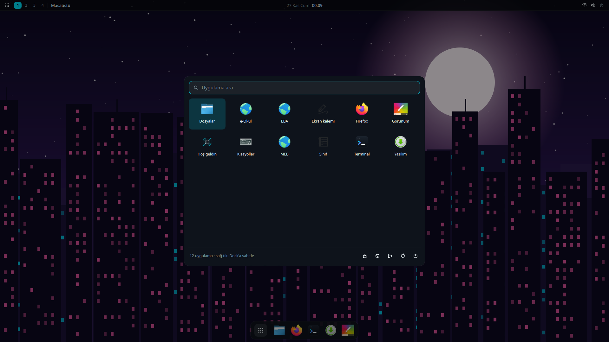
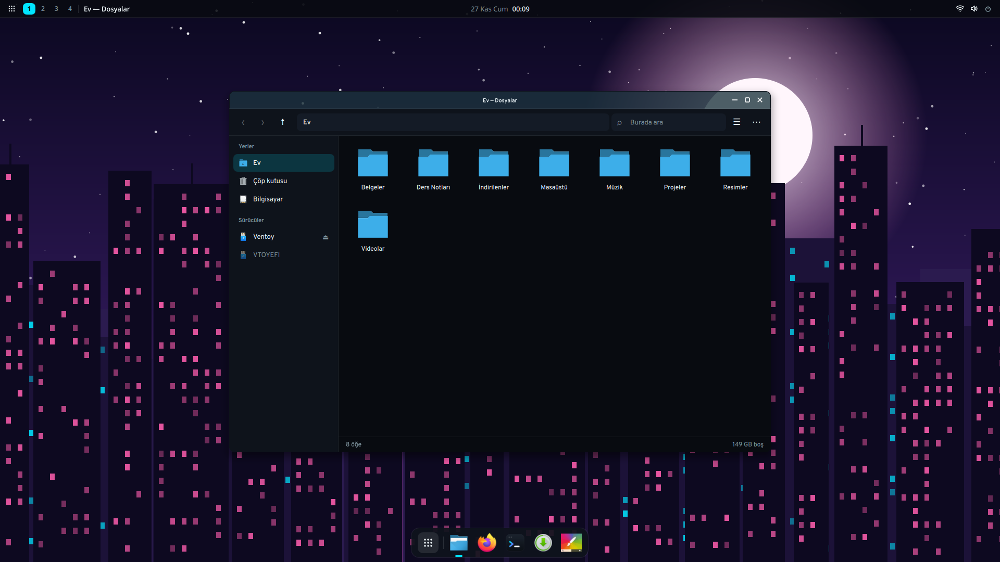
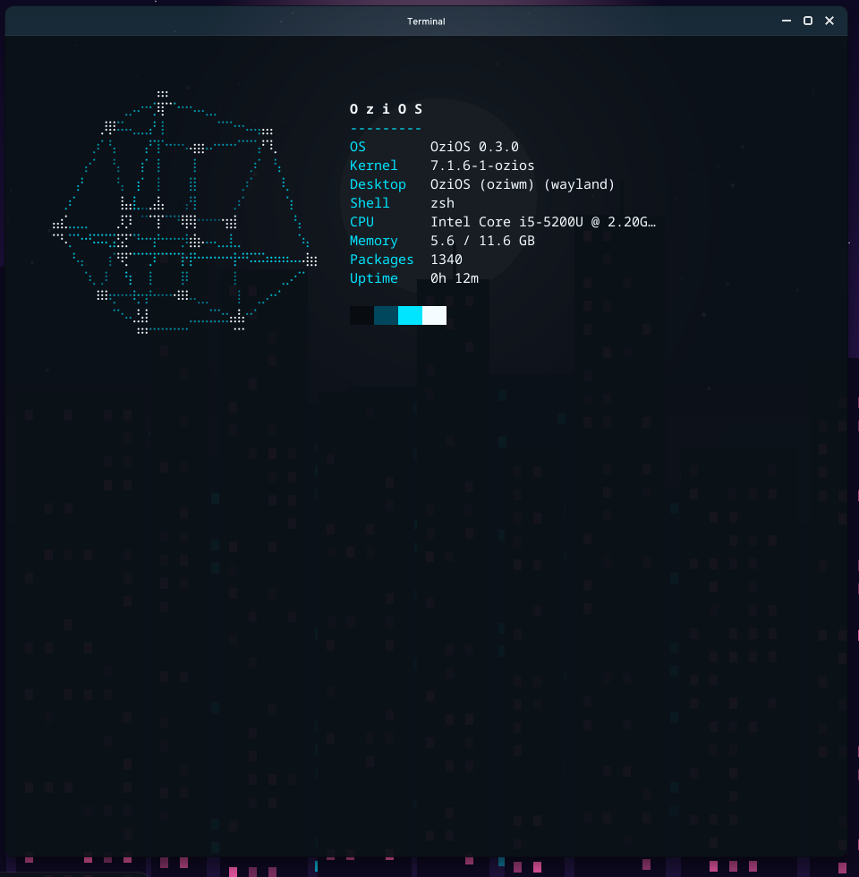
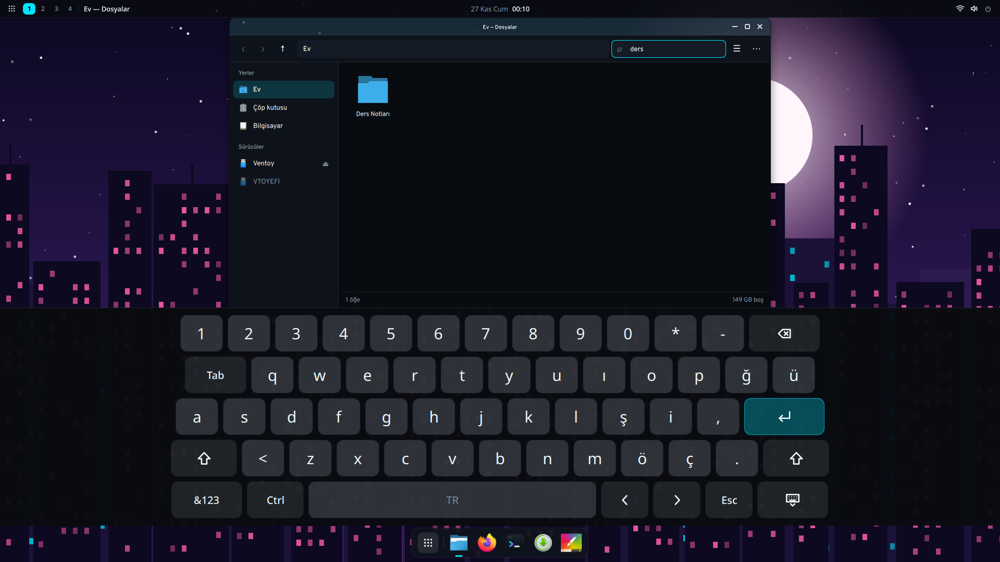

# OziOS

An Arch-based desktop system for gaming and everyday use, built on CachyOS
packages, with a desktop of its own written from scratch. It aims to be quick on ordinary hardware and easy
for people who do not want to learn Arch first.

The launcher, Ozi Files, Ozi Terminal and, in the Education edition, the
on-screen keyboard on a smart board:

**Status: early development.** A live ISO boots to the OziOS desktop on the
OziOS kernel in a virtual machine, the installer puts it on a disk and the
result starts, and the package installer works for `.deb`, AppImage and Arch
packages. The 0.4 desktop (`ozi-desktop`) runs as the daily session on a real
PC; it is still a beta. See
[docs/DEVELOPMENT.md](docs/DEVELOPMENT.md).

**Download:** [OziOS ISO](https://archive.org/download/ozios/ozios.iso) (3.5 GB) ·
[OziOS Education ISO](https://archive.org/download/ozios/ozios-edu.iso) for smart boards (3.7 GB) ·
[SHA256SUMS](https://archive.org/download/ozios/SHA256SUMS) · the same files in two parts on the
[GitHub release](https://github.com/OziiDev/OziOS/releases/tag/iso).

To try it, follow [docs/INSTALL.md](docs/INSTALL.md): put the ISO on a USB stick,
start from it, press Install.

## What it is

- **A desktop of its own (0.4, `ozi-desktop`).** `oziwm`, a Wayland compositor
  written in Rust on Smithay, draws the windows: a glow in the theme colours
  around the focused one, rounded corners, tiling (Super+T), four workspaces,
  its own lock screen. `ozi-shell` (Qt/QML) is the bar, dock, launcher, quick
  settings (Wi-Fi, Bluetooth, airplane mode, brightness, sound, power) and
  notifications. On Arch or CachyOS: `yay -S ozi-desktop`.
- **The 0.3 Plasma desktop on top of KWin.** Its own dock (icons grow toward the
  pointer, hop while a program starts), its own launcher, window motion, a
  Plasma style for the bar and every popup, and a living tesseract wallpaper
  that stops whenever a window covers it. Six colour themes (`ozi theme`):
  Cyan `#00E5FF` on ink `#080B10` by default, plus Aurora, Ember, Mint, Rose
  and a light Frost. See [desktop/README.md](desktop/README.md).
- **A package installer that explains itself.** It reviews a package before
  installing it, runs Debian and Ubuntu `.deb` files in an isolated rootless
  container and AppImages in a sandbox, builds AUR packages in a throwaway
  container, and gives every contained app one set of permissions: internet,
  files, camera, sound, devices.
- **Next to Windows.** The shared folders of Windows computers on the network
  open from the Welcome window; in VirtualBox the folders shared with a Windows
  host open in the file manager; installed beside Windows, the clock stays right
  in both systems.
- **Its own kernel.** The CachyOS kernel recipe, built as `linux-ozios` and
  released from this repository. The image and the installed system carry no
  CachyOS kernel, program or artwork.
- **An Education edition** for smart boards: board layout, a screen pen,
  whiteboard, a classroom app (student picker, groups, timer), Turkish
  defaults. See [docs/EDUCATION.md](docs/EDUCATION.md); a Turkish guide for
  teachers is in [docs/EGITIM.md](docs/EGITIM.md).

## Layout

| Folder | What is in it |
|---|---|
| `branding/` | logo, wallpaper, colour schemes, terminal greeting |
| `desktop/` | Plasma theme, layout, splash and the wallpaper plugin |
| `edu/` | the Education edition: board layout, school defaults, links |
| `python/ozipkg/` | package review, containment and permissions (no GUI code) |
| `packages/` | the `ozios-settings` package and the `ozi` command |
| `oziwm/` | the window manager (Rust, Smithay) |
| `shell/`, `session/` | ozi-shell (bar, dock, launcher, quick settings) and the session |
| `kernel/` | build the OziOS kernel |
| `iso/` | turn a CachyOS ISO into an OziOS ISO |
| `docs/` | design, development notes, releasing, licences |
| `tools/` | build and test helpers |
| `tests/` | unit tests: `python -m unittest discover -s tests` |

## Licence

MIT for the code in this repository. Files derived from KDE, CachyOS or other
projects keep their own licences.

Turkish: [README.tr.md](README.tr.md)
