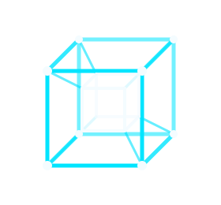

# OziOS

An Arch-based desktop system for gaming and everyday use, built on CachyOS
packages and KDE Plasma 6. It aims to be quick on ordinary hardware and easy
for people who do not want to learn Arch first.

**Status: early development.** A live ISO boots to the OziOS desktop on the
OziOS kernel in a virtual machine, and the package installer works for `.deb`,
AppImage and Arch packages. The Windows layer has not run on a real guest yet
and nothing has been tried on real hardware. See
[docs/DEVELOPMENT.md](docs/DEVELOPMENT.md).

## What it is

- **A desktop of its own on top of Plasma.** Top bar, floating dock, a
  tesseract wallpaper that stops moving whenever a window covers it, matching
  terminal, boot menu and login splash. Cyan `#00E5FF` on ink `#080B10` with
  ice `#F4FCFF` for text.
- **A package installer that explains itself.** It reviews a package before
  installing it, runs Debian and Ubuntu `.deb` files in an isolated rootless
  container and AppImages in a sandbox, builds AUR packages in a throwaway
  container, and gives every contained app one set of permissions: internet,
  files, camera, sound, devices.
- **Windows programs from the file manager** (in progress). `.exe` and `.msi`
  files open through a Windows guest that is installed from your own Windows
  ISO, with telemetry and bundled apps removed. OziOS does not ship Windows.
- **Its own kernel.** The CachyOS kernel recipe, built as `linux-ozios` and
  released from this repository. The image and the installed system carry no
  CachyOS kernel, program or artwork.
- **An Education edition** for smart boards: board layout, a screen pen,
  whiteboard, Turkish defaults. See [docs/EDUCATION.md](docs/EDUCATION.md).

## Layout

| Folder | What is in it |
|---|---|
| `branding/` | logo, wallpaper, colour schemes, terminal greeting |
| `desktop/` | Plasma theme, layout, splash and the wallpaper plugin |
| `edu/` | the Education edition: board layout, school defaults, links |
| `python/ozipkg/` | package review, containment and permissions (no GUI code) |
| `packages/` | the `ozios-settings` package and the `ozi` command |
| `winbridge/`, `winimage/` | Windows guest setup and launcher |
| `kernel/` | build the OziOS kernel |
| `iso/` | turn a CachyOS ISO into an OziOS ISO |
| `docs/` | design, development notes, releasing, licences |
| `tools/` | build and test helpers |
| `tests/` | unit tests: `python -m unittest discover -s tests` |

## Licence

MIT for the code in this repository. Files derived from KDE, CachyOS or other
projects keep their own licences.

Turkish: [README.tr.md](README.tr.md)
