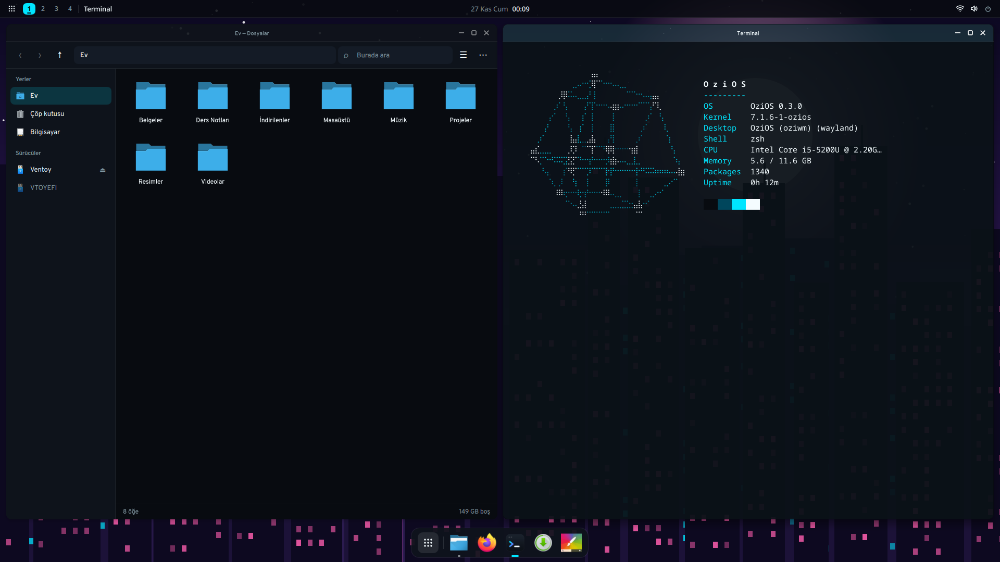
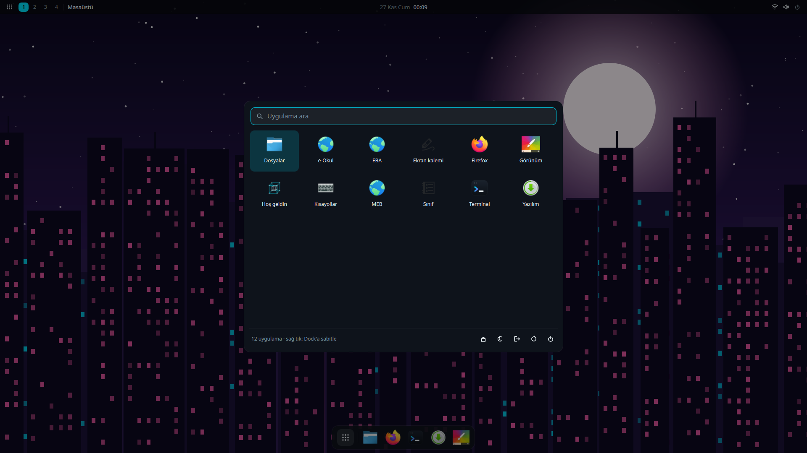
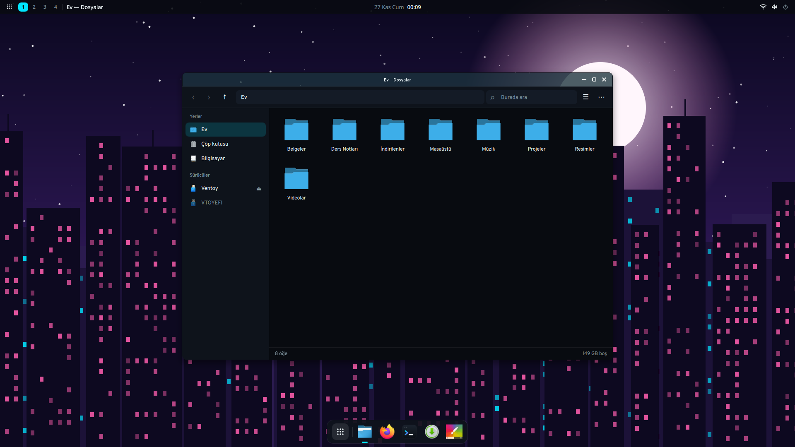
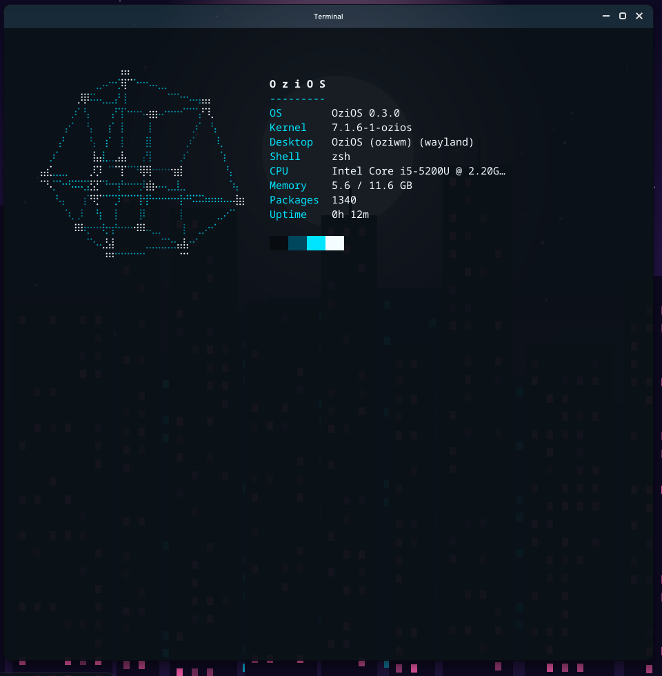
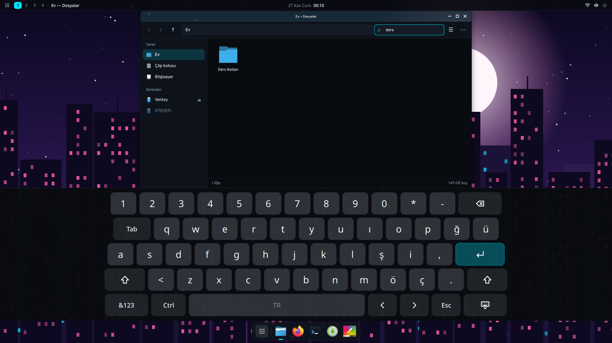

# OziOS

CachyOS paketleri üstüne kurulu, sıfırdan yazılmış kendi masaüstüne sahip, oyun ve günlük kullanım için
Arch tabanlı bir masaüstü sistemi. Sıradan donanımda hızlı olmayı ve önce Arch
öğrenmek istemeyenler için kolay olmayı hedefliyor.

**Durum: erken geliştirme.** Canlı ISO sanal makinede OziOS çekirdeği ve
masaüstüyle açılıyor; paket kurucu `.deb`, AppImage ve Arch paketleri için
çalışıyor. 0.4 masaüstü (`ozi-desktop`) gerçek bir bilgisayarda günlük oturum
olarak çalışıyor; hâlâ beta. Ayrıntılar: [docs/DEVELOPMENT.md](docs/DEVELOPMENT.md).

Denemek için: [docs/KURULUM.md](docs/KURULUM.md). ISO'yu USB belleğe koy, bellekten
başlat, Kur'a bas.

- **Kendi masaüstü (0.4, `ozi-desktop`):** pencereleri Rust ile Smithay üstüne
  yazılmış Wayland bileşimcisi `oziwm` çizer: odaktaki pencerenin çevresinde
  tema renklerinde ışıltı, yuvarlak köşeler, döşeme (Super+T), dört masaüstü,
  kendi kilit ekranı. `ozi-shell` (Qt/QML) çubuk, dock, başlatıcı, hızlı ayarlar
  (Wi-Fi, Bluetooth, uçak modu, parlaklık, ses, güç) ve bildirimlerdir. Arch ya
  da CachyOS'ta: `yay -S ozi-desktop`.
- **KWin üstünde 0.3 Plasma masaüstü:** kendi dock'u (simgeler fareye doğru büyür,
  açılan program zıplar), kendi başlatıcısı, pencere hareketleri, çubuk ve tüm
  açılır pencereler için kendi Plasma stili, pencere kapatınca duran canlı
  tesseract duvar kâğıdı. Altı renk teması (`ozi theme`): Camgöbeği, Kutup
  Işığı, Kor, Nane, Gül ve açık renkli Ayaz. Ayrıntı: [desktop/README.md](desktop/README.md).
- **Kendini anlatan paket kurucu:** kurmadan önce paketi inceler,
  Debian/Ubuntu `.deb` paketlerini izole bir kutuda, AppImage dosyalarını bir
  kum havuzunda çalıştırır, AUR paketlerini atılabilir bir kapta derler, her
  izole uygulamaya tek tip izin verir.
- **Windows ile yan yana:** ağdaki Windows bilgisayarlarının paylaşılan
  klasörleri Hoş Geldin penceresinden tek tıkla açılır; VirtualBox'ta
  Windows'la paylaşılan klasörler dosya yöneticisinde açılır; Windows'un yanına
  kurulunca saat iki sistemde de doğru kalır.
- **Kendi çekirdeği:** CachyOS çekirdek tarifi `linux-ozios` adıyla derlenir
  ve bu depodan yayımlanır. İmajda ve kurulan sistemde CachyOS çekirdeği,
  programı ya da görseli yok.
- **Akıllı tahtalar için Eğitim sürümü:** tahta düzeni, ekran kalemi, beyaz
  tahta, sınıf uygulaması (öğrenci seçici, gruplar, zamanlayıcı), Türkçe
  varsayılanlar. Öğretmen kılavuzu: [docs/EGITIM.md](docs/EGITIM.md); teknik
  ayrıntılar: [docs/EDUCATION.md](docs/EDUCATION.md).

Lisans: bu depodaki kod MIT. KDE, CachyOS ve diğer projelerden türeyen
dosyalar kendi lisanslarını korur.
